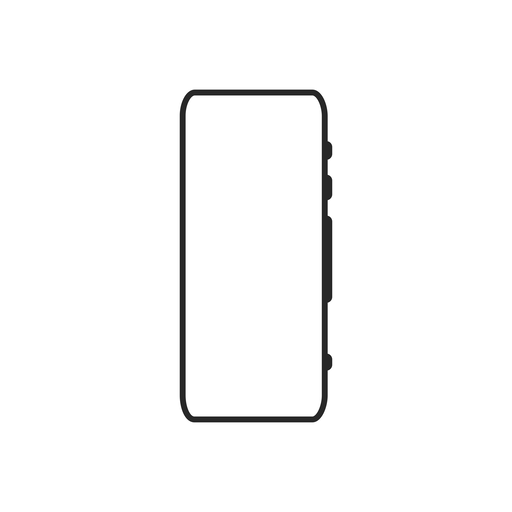

<h3 align="left">BTR15 Tool</h3>

A jailbreak for the FiiO BTR15 DAC/Amp that installs persistent custom firmware through the device's own Bluetooth update path.

### Contents

- [`app/`](app/README.md) — the Android app: patches, signs and flashes over Bluetooth SPP
- [`docs/Protocol.md`](docs/Protocol.md) — GAIA v1 + Qualcomm Upgrade over Bluetooth SPP
- [`docs/Package-Format.md`](docs/Package-Format.md) — the `APPUHDR5` container, the RSA-PSS signature scheme
- [`docs/Signing-Key.md`](docs/Signing-Key.md) — how the trusted RSA key is stored inside Apps P1 and how it is replaced
- [`docs/Patches.md`](docs/Patches.md) — automute fix, developer signing key
- [`docs/Jailbreak.md`](docs/Jailbreak.md) — stage → expected `0x003d` rejection → one-word journal edit → cold power cycle → zero-byte resume → commit, including interruption recovery
- [`docs/Stock-Restore.md`](docs/Stock-Restore.md) — returning to genuine stock in two stages, with a way to prove that FiiO signatures are trusted again

As with any firmware flash, a botched update can brick the device. By using the app or following any documentation or procedure provided in this repository, you assume full responsibility for the risk of bricking your device. I am not responsible for any damages, but I will gladly help resolve issues if necessary
